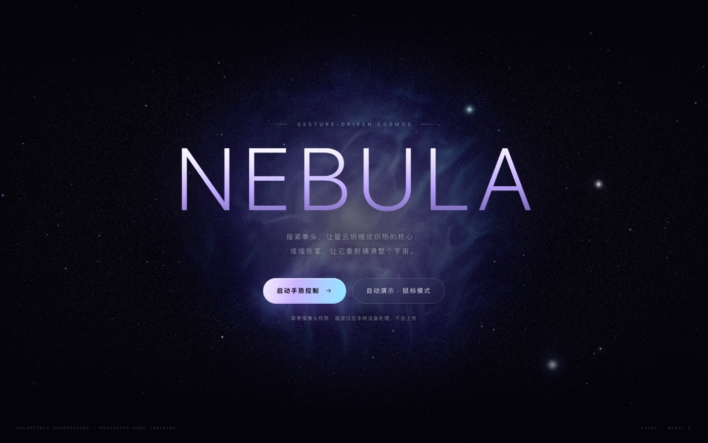
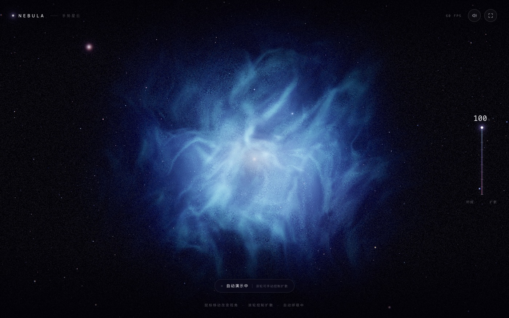

# NEBULA · 手势星云

用摄像头手势控制一团体积星云：**握紧拳头，星云坍缩成炽热的核心；缓缓张掌，让它重新铺满整个宇宙。**



纯前端实现，无后端、无视频上传。摄像头画面只在本机浏览器里被 MediaPipe 解析。

## 快速开始

环境：Node.js 20+，Chrome / Edge 最新版或 Safari 16+，需要 WebGL 2。

```bash
npm install --include=dev
npm run dev
```

打开终端输出的地址（默认 <http://localhost:5173>）。

首次启动会自动准备本地资源：

- 把 MediaPipe WASM 复制到 `public/wasm`
- 下载 7.5 MB 手部模型到 `public/models/hand_landmarker.task`

之后可完全离线运行。也可以手动执行 `npm run prepare-assets`。

> 摄像头只在 **localhost** 或 **HTTPS** 页面可用。直接双击 `index.html` 打开是调用不了摄像头的。

## 玩法

| 操作 | 星云反应 |
| --- | --- |
| 握拳 | 坍缩：变小、变密、升温，核心泛出暖白与玫红，出现吸积盘 |
| 张开手掌 | 扩散：铺满画面、变冷，转成蓝青色调，中心露出一颗新生恒星 |
| 移动手掌 | 镜头视差，星云随手的位移轻微改变视角 |
| 转动手腕 | 星云整体旋转 |
| 没有摄像头 | 点「自动演示 · 鼠标模式」：自动呼吸，移动鼠标看视差，滚轮控制扩散 |
| `M` 键 / 右上角喇叭 | 静音 / 恢复 |

手势建议：手掌距镜头约 **40–70 cm**，光线充足，**手掌或手背朝向镜头皆可**，整只手尽量在画面内。左下角小窗会实时画出识别到的 21 个关节点，用来确认追踪状态。

## 原理

- **体积星云**：Three.js 全屏 ray marching。使用一张 64³ 可平铺 3D 噪声纹理（R 软 fbm、G ridged 细丝、B 高频细节、A 大尺度），domain warp 产生卷须，44 步步进、动态步进区间与抖动消除层带；半分辨率 HDR 渲染，合成时做锐化，再叠加 UnrealBloom、ACES tone mapping、色差、暗角和胶片颗粒。收缩/扩张不只是缩放：密度阈值、中心空腔、吸积盘、核心温度、调色和星空景深都随 openness 变化。
- **手势识别**：MediaPipe HandLandmarker（GPU delegate，检测循环节流到 25fps，减少与渲染抢主线程）。由 21 个关节点计算各指节弯曲角，混入指尖—掌心距离，得到 0–1 的 openness；One Euro 滤波 + 弹簧动力学让星云有质量感。阈值在 MediaPipe 官方标准手势 landmark 上校验过：握拳 `0.00`、单指指天 `0.22`、剪刀手 `0.54`、张掌 `1.00`。
- **自适应画质**：按实测 FPS 在 `0.46–0.86` 之间调整星云渲染分辨率，DPR 上限 `1.25`；Intel 核显 + 摄像头也能保持约 40–50 fps。
- **声音**：WebAudio 实时合成，无音频文件。低频 drone + 空气噪声；握拳时 sub thump、张掌时 swell，`M` 静音。
- **隐私**：视频帧只进入浏览器内的 MediaPipe，不上传；页面无后端。



## 项目结构

```
src/
  nebula/
    NebulaScene.ts        Three.js 场景、后期链路、自适应画质
    Starfield.ts          三层星空 + 亮星衍射
    shaders/
      nebula.frag         体积星云 raymarch
      final.frag          ACES / 暗角 / 颗粒 / 色差
      star.vert|frag      普通星点
      flare.vert|frag     亮星十字光芒
  hand/
    HandTracker.ts        摄像头 + MediaPipe 推理循环
    gesture.ts            21 关键点 → openness（纯函数）
  audio/Ambient.ts        生成式环境音
  ui/
    Hud.ts                界面状态、能量表、提示
    CameraPreview.ts      镜像手部骨架绘制
  lib/
    noiseTexture.ts       3D 噪声体积生成（分片 yield，带进度）
    motion.ts             弹簧、阻尼、One Euro
  main.ts                 状态机与主循环
scripts/prepare-assets.mjs
```

## 脚本

```bash
npm run dev              # 开发服务器（自动准备模型/WASM）
npm run build            # tsc 类型检查 + 生产构建
npm run preview          # 预览 dist
npm run prepare-assets   # 仅准备模型/WASM
```

## URL 参数（演示 / 调试）

- `?mode=demo`：跳过权限门，直接进入自动演示
- `&expand=0.65`：固定展开度（0–1），适合截图或展台循环
- `&quality=0.55`：固定星云渲染比例并关闭自适应
- `&delegate=cpu`：手部推理改用 CPU（GPU delegate 不兼容时）

示例：<http://localhost:5173/?mode=demo&expand=0.8>

## 想自己改

- 星云形态 / 配色：`src/nebula/shaders/nebula.frag` 里的 `spread`、`camZ`、密度阈值、`cCore / cMid / cOuter / cAccent`（两个端点分别对应握拳与张掌）、`STEPS`
- 手势手感：`src/hand/gesture.ts` 的 `FINGERS[].maxBend` 与权重；`src/main.ts` 的弹簧参数（`new Spring(...)`）
- 性能：`src/nebula/NebulaScene.ts` 的 `MIN_QUALITY / MAX_QUALITY / MAX_PIXEL_RATIO`，或减少 `STEPS`

## 常见问题

**摄像头没有反应**
必须是 `localhost` 或 HTTPS；检查地址栏摄像头权限；被 Zoom / 腾讯会议占用时也会打开失败。错误会显示在首页按钮下方。

**`vite: not found`**
当前 shell 可能设置了 `NODE_ENV=production`，npm 会跳过 devDependencies。运行 `npm install --include=dev`。

**识别不到手**
光线太暗、手离镜头太远/太近、手在画面外，或权限弹窗被拒绝后没刷新页面。看左下角预览里有没有骨架。

**帧率偏低**
应用会自动降分辨率；也可以加 `?quality=0.46` 锁定低画质。Intel 核显上开摄像头约 40–50 fps 属正常，Apple Silicon 通常满 60。

**模型下载失败**
手动下载后重新启动：

```bash
curl -L https://storage.googleapis.com/mediapipe-models/hand_landmarker/hand_landmarker/float16/1/hand_landmarker.task \
  -o public/models/hand_landmarker.task
```

**手机访问**
局域网 IP 走 HTTP 无法调用摄像头，需要 HTTPS。开发阶段可用 ngrok / cloudflared 之类的 HTTPS 隧道。

## 说明

- 首次页面加载需要从本地服务端读取约 22 MB 的 WASM + 模型，之后走浏览器缓存。
- 不支持 WebGL 2 的浏览器会显示明确的错误提示。
