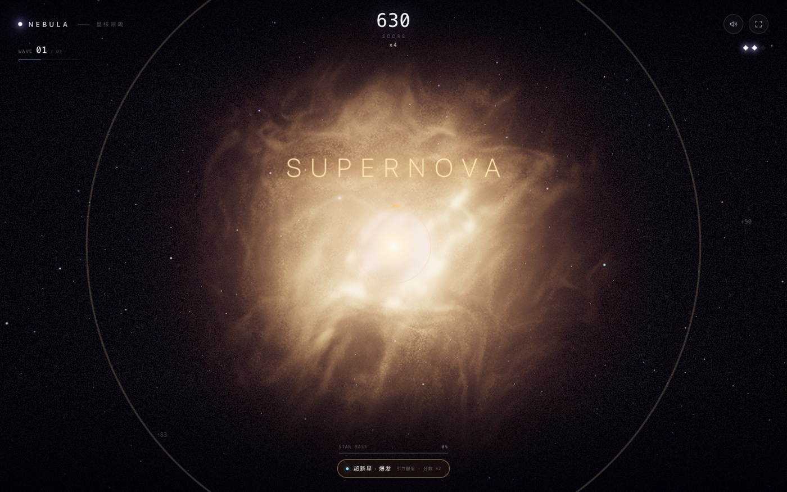
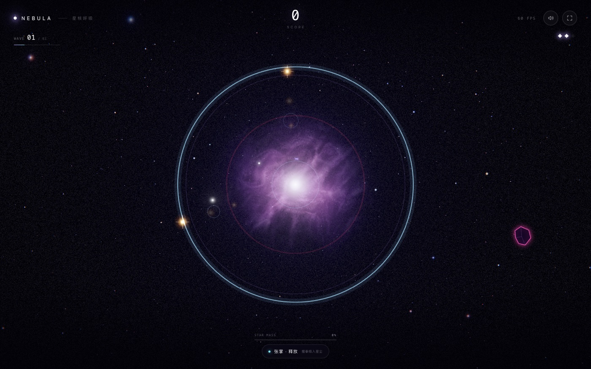

# NEBULA · 星核呼吸

> 握拳吸气，把星尘吞进核心；张掌呼气，把暗物质炸成齑粉。

一个用摄像头手势玩的体积星云游戏。整片星云就是你的身体：**握拳**让它坍缩成炽热核心，**张掌**释放冲击波。在一呼一吸之间，把一颗星养成超新星。



纯前端，无后端、无视频上传；手势识别和星云渲染都在本机浏览器里完成。没有摄像头也可以用鼠标 / 触屏完整游玩。

## 快速开始

环境：Node.js 20+，Chrome / Edge 最新版或 Safari 16+，需要 WebGL 2。

```bash
npm install --include=dev
npm run dev
```

打开终端输出的地址（默认 <http://localhost:5173>）。

首次启动会自动准备本地资源：

- 把 MediaPipe WASM 复制到 `public/wasm`
- 下载 7.5 MB 手部模型到 `public/models/hand_landmarker.task`

之后可离线运行。也可以手动执行 `npm run prepare-assets`。

> 摄像头只在 **localhost** 或 **HTTPS** 页面可用。直接双击 `index.html` 打开无法调用摄像头。

## 三种进入方式

- **开始游戏**：摄像头 + 手势。首次进入会做一次两步骤校准（握拳 / 张掌各保持约 1 秒），之后记住你的手势幅度。游戏结束回首页再开，不会重复校准。
- **自由探索 · 手势星云**：原来的星云沙盒，不做游戏判定。
- **自动演示 / 鼠标 · 触屏试玩**：不想开摄像头时使用。自动演示会自己呼吸；鼠标/触屏试玩可以完整玩一局。



## 游戏规则

### 一呼一吸

- **星尘（金色光点）**：被握拳的引力吸进核心，得分、涨“星核质量”，并额外积累压力。
- **暗物质碎片（紫红棱角）**：同样会被引力拉过来，碰到核心掉一条命。张掌的冲击波可以击碎它。
- **重暗物质（更大、更红）**：必须用**蓄力 ≥ 55%** 的冲击波才能击碎；弱波只能推开。
- **彗星（青色长尾）**：高速、高价值。握拳接住可得 90 分与大量质量；冲击波蓄力 ≥ 35% 才能击碎。
- **握拳 = 引力 + 压力**：星云越小，吸力越强，得分倍率越高；但暗物质也越容易被拉进来。
- **张掌 = 冲击波**：范围和威力由释放时的压力决定；击碎暗物质、把星尘吹走，然后压力清零。
- **核心碰撞半径**约等于画面中心那圈光环。暗物质在握拳时会被加速拉向核心，所以最刺激的一刻是：**再吸一口，还是现在就吐？**

### 压力、质量、超新星

- 按住握拳会缓慢蓄压（约 5.5 秒充满）；**每吸一颗星尘额外 +9% 压力**，吸彗星 +18%。所以想放“大波”，要先去吃星尘。
- 压力越高：引力越强、倍率越高、冲击波越大。
- 星核质量条满了会触发**超新星**：全场金色、分数 ×2、引力 ×1.35，并立刻放出一圈满蓄力冲击波；持续 7 秒，质量清零。
- 连击：每次吸收 / 击碎 +1 层，每层 +5% 分数，最高 30 层；受伤清零，6 秒不命中也会断。
- 3 波，每波 24–30 秒；波次之间清场并给分数奖励。
- 生命 3 条；暗物质撞核心 -1，彗星 -2。手部信号丢失超过约 1 秒会自动暂停，回来继续。
- 结算评级：原恒星 / 白矮星 / 中子星 / 超新星，按分数；最高分存在本地。

### 手势与校准

| 操作 | 效果 |
| --- | --- |
| 握拳 | 星云坍缩、引力吸入星尘、积累压力 |
| 张开手掌 | 星云扩散、释放冲击波、把星尘吹走 |
| 移动手掌 | 镜头视差；星云跟着轻微偏移 |
| 转动手腕 | 星云整体旋转 |
| 按住鼠标 / 触屏 | 鼠标模式下等价于握拳 |
| 松开鼠标 / 触屏 | 等价于张掌，释放冲击波 |
| `Space`（鼠标模式） | 按住蓄力，松开释放 |
| `M` | 静音 / 恢复 |

手势建议：手掌距镜头约 **40–70 cm**，光线充足，**手掌或手背朝向镜头都可以**，整只手尽量在画面内。左下角预览会画出识别到的骨架。

校准会记录你握拳和摊掌时的实际 openness，自动算出两档阈值；如果卡住或识别不到，可以直接「跳过校准」或「鼠标 / 触屏试玩」。校准数据只在内存里，刷新后需要重新校准。

## 技术实现

- **星云**：Three.js 全屏 ray marching。64³ 可平铺 3D 噪声纹理（R 软 fbm、G ridged 细丝、B 高频细节、A 大尺度），domain warp 产生卷须；44 步步进、动态步进区间、抖动去层带；半分辨率 HDR 渲染，合成时锐化，再叠加 UnrealBloom、ACES tone mapping、色差、暗角和胶片颗粒。收缩/扩张不是简单缩放：密度、中心空腔、吸积盘、核心温度、调色、星空景深都随状态变化；超新星时整团气体转为金白色。
- **游戏逻辑**：`src/game/Game.ts` 是纯 TS、无 DOM 的模拟层（星尘/暗物质、引力、冲击波环、波次、计分、质量、超新星、暂停），可以直接在 Node 里跑数值模拟。表现层是独立的全屏 2D canvas（预渲染 sprite、冲击环、粒子、飘字），HUD 是 DOM，因此不干扰 WebGL 后期。
- **输入**：MediaPipe HandLandmarker（GPU delegate，检测节流到 25fps），由 21 个关节点计算指节弯曲角 + 指尖/掌心距离得到 openness；One Euro 滤波 + 弹簧；游戏用更快的滤波和带滞回的拳/掌二值状态，避免摄像头抖动导致误触发。阈值在 MediaPipe 官方标准手势 landmark 上校验过：握拳 `0.00`、单指指天 `0.22`、剪刀手 `0.54`、张掌 `1.00`。
- **性能**：按实测 FPS 在 `0.46–0.86` 之间自适应调整星云渲染分辨率，DPR 上限 1.25；2D 游戏层按 DPR 独立渲染。Intel 核显 + 摄像头约 35–50fps；无摄像头 / 鼠标模式通常满 60。
- **声音**：WebAudio 实时合成，无音频文件。低频 drone、吸收星尘的铃声、击碎的噪声、冲击波 sub、超新星和弦；握拳时 drone 会收紧，张掌时铺开。
- **隐私**：视频帧只进入浏览器内的 MediaPipe，不上传任何数据；没有后端。

## 项目结构

```
src/
  game/
    Game.ts              纯逻辑游戏内核（可 Node 单测）
    GameRenderer.ts      全屏 2D 游戏层（sprite / 冲击波 / 粒子）
    GameUI.ts            HUD、校准、结算、生命与提示
    Calibration.ts       两步骤手势校准与阈值
  nebula/
    NebulaScene.ts       Three.js 场景、后期链路、自适应画质
    Starfield.ts         三层星空 + 亮星衍射
    shaders/             星云 raymarch / 星空 / 最终合成
  hand/
    HandTracker.ts       摄像头 + MediaPipe 推理循环
    gesture.ts           21 关键点 → openness（纯函数）
  audio/Ambient.ts       生成式环境音与游戏音效
  ui/
    Hud.ts               首页 / 自由探索 HUD
    CameraPreview.ts     镜像手部骨架
  lib/
    noiseTexture.ts      3D 噪声体积生成
    motion.ts            弹簧、阻尼、One Euro
  main.ts                模式状态机、输入、游戏流程
scripts/prepare-assets.mjs
```

## 脚本

```bash
npm run dev              # 开发服务器（自动准备模型/WASM）
npm run build            # tsc 类型检查 + 生产构建
npm run preview          # 预览 dist
npm run prepare-assets   # 仅准备模型/WASM
```

## URL 参数（演示 / 调试）

- `?mode=game`：跳过权限门，直接用鼠标模式开一局
- `?mode=demo`：自动演示
- `&expand=0.65`：固定星云展开度（0–1，适合截图；会进入自动演示）
- `&quality=0.55`：固定星云渲染比例并关闭自适应
- `&delegate=cpu`：手部推理改用 CPU（GPU delegate 不兼容时）

示例：<http://localhost:5173/?mode=game>

## 常见问题

**摄像头没有反应**
必须是 `localhost` 或 HTTPS；检查地址栏摄像头权限；被 Zoom / 腾讯会议占用时也会打开失败。错误会显示在首页按钮下方。

**`vite: not found`**
当前 shell 可能设置了 `NODE_ENV=production`，npm 会跳过 devDependencies。运行 `npm install --include=dev`。

**识别不到手 / 校准不前进**
光线太暗、手离镜头太远/太近、手在画面外，或权限弹窗被拒绝后没刷新页面。看左下角预览里有没有骨架；实在不行点「跳过校准」或「鼠标 / 触屏试玩」。

**一握拳就掉血**
暗物质也会被引力拉过来，这是设计。蓄力后及时张掌放波，或者先用弱拳把星尘吸进来、再吐掉暗物质。

**帧率偏低**
应用会自动降分辨率；也可以加 `?quality=0.46`。Intel 核显上开摄像头约 35–50fps 属正常，Apple Silicon 通常满 60。

**模型下载失败**
手动下载后重新启动：

```bash
curl -L https://storage.googleapis.com/mediapipe-models/hand_landmarker/hand_landmarker/float16/1/hand_landmarker.task \
  -o public/models/hand_landmarker.task
```

**手机访问**
局域网 IP 走 HTTP 无法调用摄像头，需要 HTTPS。开发阶段可用 ngrok / cloudflared 之类的 HTTPS 隧道；手机也可以直接用「鼠标 / 触屏试玩」完整玩一局。

## 已知限制

- 手势识别受光线、镜头距离和肤色/手套影响；校准和鼠标兜底就是为此准备的。
- 游戏目前是单手势维度（拳 / 掌）+ 手掌位置/旋转的轻量辅助；没有双人、没有联网排行榜。
- 首次页面加载需要从本地服务端读取约 22 MB 的 WASM + 模型，之后走浏览器缓存。
- 不支持 WebGL 2 的浏览器会显示明确错误。
